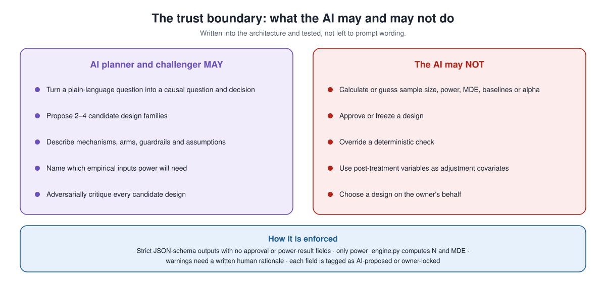
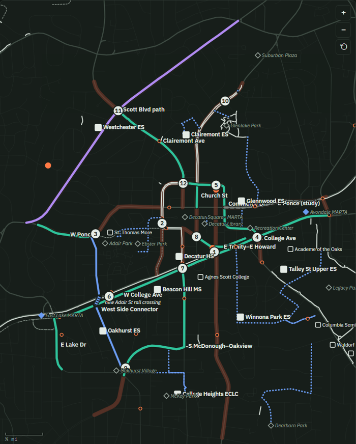
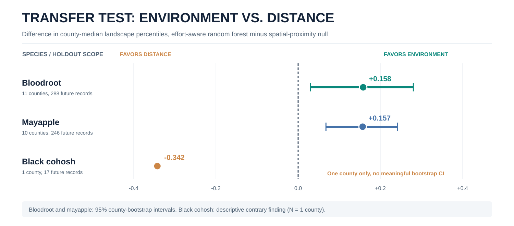
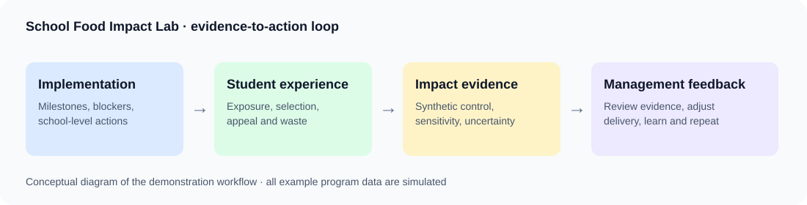

# Kraemer Lovelace

**Data Science · Experimentation · Causal Inference · Applied AI**

I lead data science and experimentation work: framing the decisions that matter, building the evidence systems behind them, and making sure teams act on results that are real rather than noise. My work combines experimentation, causal inference, applied AI, geospatial analysis, and rigorous program evaluation.

I founded [Glyph Analytics](https://glyphanalytics.com/) after 15 years at USAID leading analytics and evaluation work. My focus is on **decision systems that are scientifically defensible, technically useful, and designed for real-world implementation**.

## Portfolio

Ranked by relevance to data science and experimentation roles. Public repos include code and data sources; synthetic or illustrative data is labeled.

### 01 · Uplift Targeting — Who Should Get the Email?

<table><tr>
<td width="46%" valign="top"> Where to stop emailing depends on what a visit is worth.</td>
<td valign="top"><strong>Uplift modeling · Causal ML · Model tuning · Google Cloud</strong>  <a href="https://github.com/klovelace/uplift-targeting">View the repo</a> · <a href="https://github.com/klovelace/uplift-targeting/blob/main/MEMO.md">Decision memo</a> · <a href="https://github.com/klovelace/uplift-targeting/blob/main/MODEL_CARD.md">Model card</a>. On a 64,000-customer randomized email experiment, a regularized logistic regression out-ranked tuned random forests, LightGBM, stacking, an X-learner and a causal forest on held-out data. Emailing the top half keeps 69% of the lift, and the best cutoff jumps from half to everyone once a visit is worth about 27× an email. Personalizing which email each customer got did not beat sending everyone the men's email. Deployed as batch scoring in BigQuery ML (ONNX) and registered in Vertex AI, with cloud scores matching local to 8 × 10⁻⁹.  <strong>Status:</strong> Complete; MIT-licensed; public data downloaded and checksum-verified.</td>
</tr></table>

### 02 · Trimtab — AI-Assisted Experiment Design

<table><tr>
<td width="46%" valign="top"> The AI proposes and critiques; deterministic code and the human owner decide.</td>
<td valign="top"><strong>Experimentation · Causal inference · Human-in-the-loop AI</strong>  <a href="projects/trimtab/README.md">Explore the Trimtab case study</a> · <a href="projects/trimtab/how-trimtab-works.pdf">11-slide intro (PDF)</a>. An AI planner proposes candidate designs and a separate AI challenger attacks them. A deterministic adjudicator scores each one PASS, WARN or FAIL, and the human owner selects, supplies the empirical inputs and approves. Only a deterministic engine computes power. Designs are SHA-256 frozen, assignment is HMAC-verified, and launch requires five checks to pass together.  <strong>Status:</strong> Working system (v0.13) covering a dozen-plus design families, validated on synthetic experiments with detected and inconclusive effects. Source is private; the case study documents the architecture and results.</td>
</tr></table>

### 03 · Decatur Connects — Where Should the City Build for Safer Biking?

<table><tr>
<td width="46%" valign="top"> The proposed network, with the 12 priority intersections numbered. <a href="https://klovelace.github.io/decatur-connects/">Open the interactive map</a>.</td>
<td valign="top"><strong>Transportation safety · Geospatial analysis · Network routing</strong>  <a href="https://klovelace.github.io/decatur-connects/">Live page</a> · <a href="https://github.com/klovelace/decatur-connects">View the repo</a>. A citizen proposal for a 14.5-mile protected bike network in Decatur, Georgia, built from the city's 2019–2023 crash records (3,451 crashes), its adopted Safety Action Plan, and the OpenStreetMap street network. People walking and biking were 3% of crashes but 40% of fatal and serious ones, and 47 of the 93 walking and biking crashes happened at 12 intersections. Each of those intersections gets a crash diagnosis (left turns in 19 of 47) and federal safety countermeasures. Low-stress greenways are routed over the street network, each corridor's design is matched to its traffic volume using FHWA and NACTO guidance, and every phase is tied to a funding source. The network would put all nine public schools within a quarter mile of a low-stress route, up from five.  <strong>Status:</strong> Published November 2026 as a proposal for discussion with city staff; not an engineering design.</td>
</tr></table>

### 04 · Contact Centre Operations BI — How Many Agents Does the Phone Queue Need?

<table><tr>
<td width="46%" valign="top"> Executive dashboard on 2.26M Toronto 311 records. <a href="https://klovelace.github.io/contact-center-bi/">Open the live dashboard</a>.</td>
<td valign="top"><strong>Business intelligence · KPI design · Data governance · Forecasting</strong>  <a href="https://klovelace.github.io/contact-center-bi/">Live dashboard</a> · <a href="https://github.com/klovelace/contact-center-bi">View the repo</a>. An end-to-end BI build for the 311 Toronto Contact Centre (about 1.3 million contacts a year): an automated pipeline with logged data-quality checks (it repairs about 35,000 malformed source rows a year and reconciles every record), a star-schema model with Power BI DAX measures, a written KPI dictionary, a Holt-Winters phone-volume forecast (8.8% error on a 12-month holdout vs 12.4% for a seasonal baseline), and an Erlang C model that sizes the peak-hour team to hold 80% of calls answered in 75 seconds. Findings: self-service more than doubled its share of contacts since 2022, the service-level margin is under two points, and 5.9% of contacts are avoidable follow-ups.  <strong>Status:</strong> Complete; public City of Toronto open data; tests included.</td>
</tr></table>

### 05 · GeoEvidence — Spatial Prediction & Validation

<table><tr>
<td width="48%" valign="top"> Actual project output: geographic transfer and uncertainty validation.</td>
<td valign="top"><strong>Geospatial ML · Environmental intelligence · Research</strong>  <a href="projects/spatial-validation/README.md">Explore the research case study</a>. A 23-county GIS and spatial-ML workflow uses temporal and whole-county holdouts, observer-effort correction, and a proximity-only null to distinguish generalizable signal from geographic leakage. It reports positive, uncertain, and contrary findings.  <a href="projects/spatial-validation/assets/workflow.svg">See the real validation workflow →</a>  <strong>Status:</strong> Documented research case study; v1.0 results under revision after a pipeline audit; corrected manuscript in preparation (co-author).</td>
</tr></table>

### 06 · Glyph Evidence — Traceable AI-Assisted Evaluation

<table><tr>
<td width="38%" valign="top"><strong>Evaluation workflow</strong>  Sources → evaluation questions → themes and coding → theory-of-change tests → triangulated findings → cited report.</td>
<td valign="top"><strong>LLM applications · Human-in-the-loop AI · Evaluation</strong>  A local-first application that ties every finding, conclusion and recommendation to the exact passages behind it, across documents, spreadsheets and interview recordings. AI drafts themes, theory-of-change links and findings. Each quotation is checked character for character against its source, unsearched questions are reported as "not yet examined" rather than "no evidence," and nothing is confirmed until an evaluator reviews it. Related <a href="https://github.com/klovelace/AssessorWorkflow">AI Evaluation Operations prototypes</a> cover rubric-based assessment and rater calibration.  <strong>Status:</strong> Working application with an automated test suite and a synthetic sample project.</td>
</tr></table>

### 07 · Adaptive Programs — Decision Analytics for Program Management

<table><tr>
<td width="46%" valign="top"> The decision loop as the demonstration runs it; all example data are simulated.</td>
<td valign="top"><strong>Decision systems · Program analytics · Causal inference</strong>  <a href="projects/adaptive-programs/README.md">Explore the Adaptive Programs case study</a> and <a href="https://glyphanalytics.com/school-food/">launch the School Food Impact Lab</a>. A public interactive demonstration of the full Pinpoint → Track → Adjust → Verify loop. It locates the binding constraint (in the simulated data, 78% of students who taste the plant-based meal like it, but it is available at service only 40% of the time), tracks school-level availability and selection monthly, turns barriers into owner-assigned actions, and tests gains against synthetic-control comparisons with sensitivity checks and greenhouse-gas uncertainty.  <strong>Status:</strong> Public interactive demonstration and case study; example data are simulated.</td>
</tr></table>

## Selected analytical demonstrations

These are independent analytical product demonstrations, not claims of employment, sponsorship, or live client deployment.

| Demonstration | Decision problem |
| --- | --- |
| [Marketing incrementality and lifetime value](https://glyphanalytics.com/portfolio/marketing_ds_dashboard.html) | Separate incremental impact from attribution when allocating resources. |
| [Growth journey analytics](https://glyphanalytics.com/portfolio/stripe_journey_dashboard.html) | Identify conversion friction and prioritize experiments. |
| [Consumer growth and experimentation](https://glyphanalytics.com/HumanEval/reddit_consumer_ds_dashboard.html) | Connect retention, acquisition, and experimental evidence to product decisions. |

## How I work

**Pinpoint → Track → Adjust → Verify.** Fast feedback on noisy data teaches teams the wrong lessons. The job is to keep the decision loop short and the evidence honest.

| Step | What it means | Typical tools |
| --- | --- | --- |
| **Pinpoint** | Frame the decision and find the few drivers the outcome is most sensitive to. | Decision framing, driver and sensitivity analysis, power and minimum detectable effects |
| **Track** | Measure those drivers at the cadence decisions are actually made. | Metric design, data pipelines, monitoring dashboards, sequential looks |
| **Adjust** | Route each signal to an owner and a pre-agreed decision rule. | Decision rules, guardrail metrics, action tracking |
| **Verify** | Separate real effects from noise and trend before scaling. | Randomized experiments, difference-in-differences, synthetic control, cluster-robust inference, sensitivity tests |

The [School Food Impact Lab](projects/adaptive-programs/README.md) runs the whole loop end to end; [Trimtab](projects/trimtab/README.md) builds the Verify step into experiment design itself.

## Additional engineering & research

| Project | Demonstrated work |
| --- | --- |
| **[Practice Mark](https://github.com/klovelace/practice-mark)** | Shipped unlisted Chrome extension beta for hands-free YouTube practice loops, marks, and playback controls. [Real-product screenshot capture plan](https://github.com/klovelace/practice-mark/blob/main/docs/PORTFOLIO_VISUALS.md). |
| **[AI Evaluation Operations](https://github.com/klovelace/AssessorWorkflow)** | Three independent interactive prototypes for scoring rubrics, rater calibration, and evaluation-operations health; illustrative data, not live operations. |
| **[Monitoring Tools Compendium](https://github.com/klovelace/MonitoringTools)** | Historical reference collection of monitoring frameworks, surveys, and indicator resources for international development. |
| **[Veiled Vote](projects/veiled-vote/README.md)** | Exploratory multi-agent simulation of receipt-free preference elicitation and adversarial attacks on institutional safeguards, with three published charts. |

## Methods & tools

**Methods:** Randomized experiments, KPI design and data governance, demand forecasting and workforce planning, causal inference, difference-in-differences, matching, interrupted time series, monitoring and evaluation, survey research, and geospatial analysis.

**Tools:** Python, SQL, R, Stata, JavaScript, Tableau, GIS, dashboards, and analytical workflow development.

**Leadership:** Analytical strategy, interdisciplinary teams, stakeholder engagement, and decision-focused communication.

## Background & contact

Former senior data science and analytics leader at USAID · M.P.A., Policy Analysis, University of Georgia · B.A., Economics and Computer Science, Sewanee · Atlanta area.

**[Glyph Analytics](https://glyphanalytics.com/)**

---

*Trimtab and Glyph Evidence source code is private. Examples that use synthetic or illustrative data are labeled as such.*
