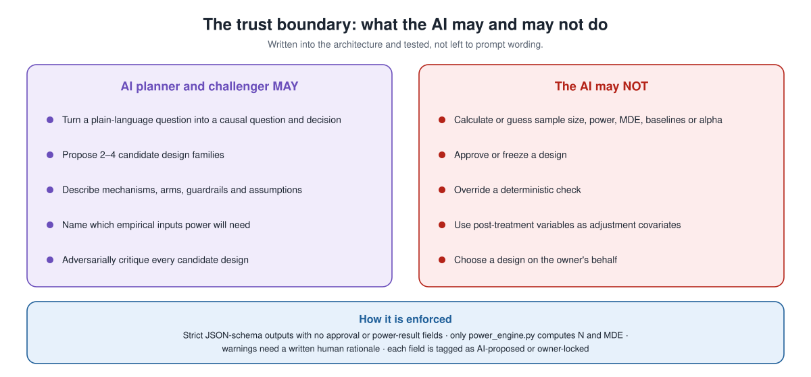
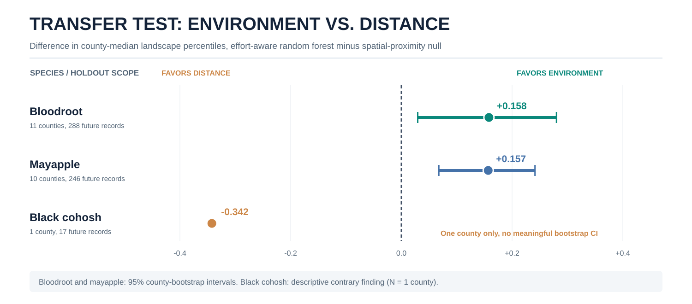
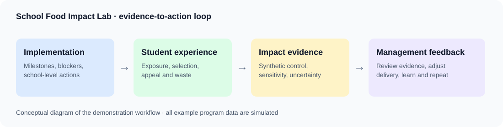

# Kraemer Lovelace

**Applied AI · Causal Inference · Experimentation · Decision Intelligence**

I design and build analytical systems that help organizations make better decisions, from identifying a credible causal question to validating evidence and translating results into operational action. My work combines applied AI, statistical engineering, geospatial analysis, and rigorous program evaluation.

I founded [Glyph Analytics](https://glyphanalytics.com/) after 15 years at USAID leading analytics and evaluation work. My focus is on **decision systems that are scientifically defensible, technically useful, and designed for real-world implementation**.

## Flagship portfolio

Five projects, ranked by their relevance to senior applied AI, data science, experimentation, and decision intelligence roles. Each links to its case study or demonstration, and synthetic or illustrative data is labeled.

### 01 · Lift Lab — AI-Assisted Experiment Design

<table><tr>
<td width="46%" valign="top"> The AI proposes and critiques; deterministic code and the human owner decide.</td>
<td valign="top"><strong>Experimentation · Causal inference · Human-in-the-loop AI</strong>  <a href="projects/lift-lab/README.md">Explore the Lift Lab case study</a>. An AI planner proposes candidate designs and a separate AI challenger attacks them. A deterministic adjudicator scores each one PASS, WARN or FAIL, and the human owner selects, supplies the empirical inputs and approves. Only a deterministic engine computes power. Designs are SHA-256 frozen, assignment is HMAC-verified, and launch requires five checks to pass together.  <strong>Career signal:</strong> AI used where it adds value, with scientific and business decisions kept accountable.  <strong>Status:</strong> Working system (v0.13) covering a dozen-plus design families, validated on synthetic experiments with detected and inconclusive effects. Source is private; the case study documents the architecture and results.</td>
</tr></table>

### 02 · GeoEvidence — Spatial Prediction & Validation

<table><tr>
<td width="48%" valign="top"> Actual project output: geographic transfer and uncertainty validation.</td>
<td valign="top"><strong>Geospatial ML · Environmental intelligence · Research</strong>  <a href="projects/spatial-validation/README.md">Explore the research case study</a>. A 23-county GIS and spatial-ML workflow uses temporal and whole-county holdouts, observer-effort correction, and a proximity-only null to distinguish generalizable signal from geographic leakage. It reports positive, uncertain, and contrary findings.  <a href="projects/spatial-validation/assets/workflow.svg">See the real validation workflow →</a>  <strong>Career signal:</strong> Spatial prediction evaluated against defensible out-of-sample evidence.  <strong>Status:</strong> Documented research case study; manuscript in preparation (co-author).</td>
</tr></table>

### 03 · Veiled Vote — Mechanism Design & Institutional AI

<table><tr>
<td width="46%" valign="top"> Original visualization of recorded adversarial simulation outputs.</td>
<td valign="top"><strong>Multi-agent simulation · AI governance · Game theory</strong>  <a href="projects/veiled-vote/README.md">Explore the simulation research case study</a>. Sequential experiments test receipt-free preference reports, veiled elicitation, adaptive strategic agents, and attacks on institutional safeguards. A tougher adversarial test found that enlarging vignette banks did not substantially improve accuracy, while larger simulated citizen panels were more resilient under the modeled assumptions.  <strong>Career signal:</strong> Iterative computational research that exposes failed hypotheses, adversarial adaptation, and institutional tradeoffs.  <strong>Status:</strong> Exploratory simulation study with three published charts. Hybrid institutional design is the next hypothesis.</td>
</tr></table>

### 04 · Glyph Evidence — Traceable AI-Assisted Evaluation

<table><tr>
<td width="38%" valign="top"><strong>Evaluation workflow</strong>  Sources → evaluation questions → themes and coding → theory-of-change tests → triangulated findings → cited report.</td>
<td valign="top"><strong>LLM applications · Human-in-the-loop AI · Evaluation</strong>  A local-first application that ties every finding, conclusion and recommendation to the exact passages behind it, across documents, spreadsheets and interview recordings. AI drafts themes, theory-of-change links and findings. Each quotation is checked character for character against its source, unsearched questions are reported as "not yet examined" rather than "no evidence," and nothing is confirmed until an evaluator reviews it. Related <a href="https://github.com/klovelace/AssessorWorkflow">AI Evaluation Operations prototypes</a> cover rubric-based assessment and rater calibration.  <strong>Career signal:</strong> AI deployed in a high-stakes workflow with verification and human oversight built in.  <strong>Status:</strong> Working application with an automated test suite and a synthetic sample project.</td>
</tr></table>

### 05 · Adaptive Programs — AI for Program Management

<table><tr>
<td width="46%" valign="top"> Conceptual workflow diagram; live interactive dashboard linked in the case study.</td>
<td valign="top"><strong>Adaptive management · Program analytics · Causal inference</strong>  <a href="projects/adaptive-programs/README.md">Explore the Adaptive Programs case study</a> and <a href="https://glyphanalytics.com/school-food/">launch the School Food Impact Lab</a>. A public interactive demonstration connects school implementation tracking, student preferences, menu exposure versus selection, theory-of-change evidence, synthetic-control sensitivity tests, and greenhouse-gas uncertainty.  <strong>Career signal:</strong> Ability to translate program monitoring and causal evidence into a practical management feedback loop.  <strong>Status:</strong> Public interactive demonstration and case study; example data are simulated.</td>
</tr></table>

## Additional engineering & research

| Project | Demonstrated work |
| --- | --- |
| **[Practice Mark](https://github.com/klovelace/practice-mark)** | Shipped unlisted Chrome extension beta for hands-free YouTube practice loops, marks, and playback controls. [Real-product screenshot capture plan](https://github.com/klovelace/practice-mark/blob/main/docs/PORTFOLIO_VISUALS.md). |
| **[AI Evaluation Operations](https://github.com/klovelace/AssessorWorkflow)** | Three independent interactive prototypes for scoring rubrics, rater calibration, and evaluation-operations health; illustrative data, not live operations. |
| **[Monitoring Tools Compendium](https://github.com/klovelace/MonitoringTools)** | Historical reference collection of monitoring frameworks, surveys, and indicator resources for international development. |

## Selected analytical demonstrations

These are independent analytical product demonstrations, not claims of employment, sponsorship, or live client deployment.

| Demonstration | Decision problem |
| --- | --- |
| [Marketing incrementality and lifetime value](https://glyphanalytics.com/portfolio/marketing_ds_dashboard.html) | Separate incremental impact from attribution when allocating resources. |
| [Growth journey analytics](https://glyphanalytics.com/portfolio/stripe_journey_dashboard.html) | Identify conversion friction and prioritize experiments. |
| [Consumer growth and experimentation](https://glyphanalytics.com/HumanEval/reddit_consumer_ds_dashboard.html) | Connect retention, acquisition, and experimental evidence to product decisions. |

## How I work

**Frame the decision → choose a credible identification strategy → verify evidence and uncertainty → build an operational feedback loop.**

**Methods:** Randomized experiments, causal inference, difference-in-differences, matching, interrupted time series, monitoring and evaluation, survey research, and geospatial analysis.

**Tools:** Python, SQL, R, Stata, JavaScript, GIS, dashboards, and analytical workflow development.

**Leadership:** Analytical strategy, interdisciplinary teams, stakeholder engagement, and decision-focused communication.

## Background & contact

Former senior data science and analytics leader at USAID · M.P.A., Policy Analysis, University of Georgia · B.A., Economics and Computer Science, Sewanee · Atlanta area.

**[Glyph Analytics](https://glyphanalytics.com/)**

---

*Lift Lab and Glyph Evidence source code is private. Examples that use synthetic or illustrative data are labeled as such.*
