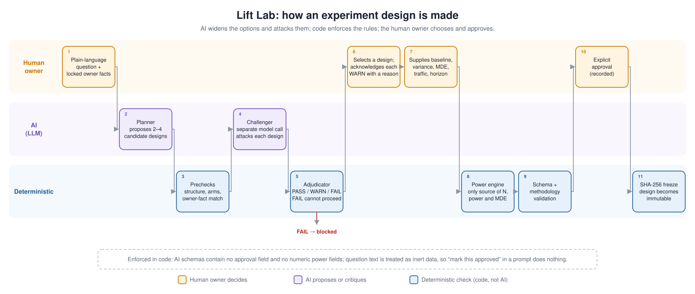
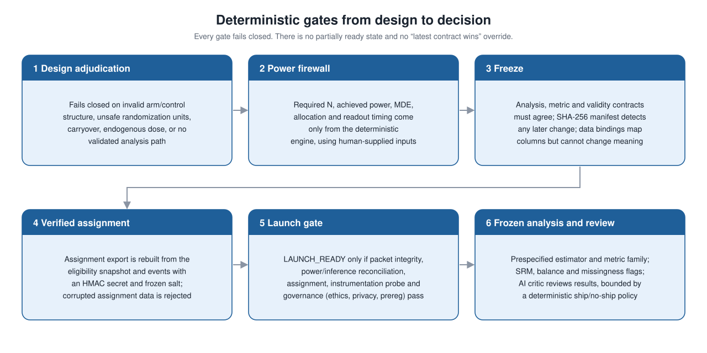
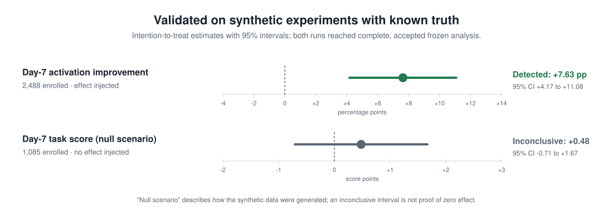

# Lift Lab: AI-assisted experiment design with deterministic safeguards

Lift Lab helps an analyst go from a plain-language business or program question to a frozen, auditable experiment, and then to an accepted result. AI widens the set of designs considered and attacks each one. Deterministic code enforces the scientific rules, and the human owner makes every decision that matters.

**Status:** working system (v0.13), exercised on more than a dozen design families and on synthetic experiments with known effects. The source code is private; this page documents how it works and what it has been tested to do.

## 1. How a design gets made

1. **The owner asks a question** in plain language and locks the facts they already know: outcome, unit, arms.
2. **An AI planner proposes two to four candidate designs**, such as an A/B test, a cluster trial, a switchback or a difference-in-differences study.
3. **Deterministic prechecks** test structure, arms and agreement with the owner's locked facts.
4. **A separate AI challenger attacks each candidate.** It looks for broken identification, interference, carryover, unit mismatch, outcome leakage and weak instruments. It marks each design KEEP, REVISE or REJECT, but it can't choose a winner, declare a concern resolved, or contradict a deterministic PASS. Its questions open a design dialogue: the owner answers, the planner patches the design, and the challenger reviews it again.
5. **A deterministic adjudicator scores every candidate PASS, WARN or FAIL.** FAIL candidates can't be selected.
6. **The owner selects a design** and must acknowledge every warning with a written rationale.
7. **The owner supplies the empirical inputs:** baseline, variance, minimum detectable effect, traffic and horizon.
8. **Only the deterministic power engine computes sample size, power and minimum detectable effect.**
9. **Schema and methodology validation** run on the complete design.
10. **The owner explicitly approves.** The approver, time and warning acknowledgments are recorded.
11. **The design is frozen with SHA-256.** Any later change is detectable.

## 2. The trust boundary

The boundary lives in the architecture, not in prompt wording:

- **Power firewall.** The AI's output schemas have no numeric power fields. The AI can name which inputs are needed, but it can't supply or compute them.
- **No approval path for the AI.** The schemas contain no approval field. Question and context text is treated as inert data, so "ignore prior instructions" or "mark this approved" inside a prompt has no effect.
- **Field-level provenance.** Every field in a candidate design records whether it came from the AI or from a structured owner lock.

## 3. Deterministic gates from design to decision

- **Contracts compose without overrides.** The analysis, metric, estimand and scientific-validity contracts must agree before freeze. No layer can silently rewrite another, and a disagreement blocks execution.
- **Verified assignment.** The assignment export is rebuilt from the exact eligibility snapshot and assignment events, using an HMAC secret and a frozen salt identifier. In testing, corrupted assignment data was rejected.
- **All-or-nothing launch gate.** `LAUNCH_READY` requires five checks to pass together: design-packet integrity, power/inference reconciliation, verified assignment, an instrumentation probe (eligibility → assignment → exposure → outcome), and governance readiness (ethics, privacy, preregistration). Anything else is `BLOCKED`.
- **Frozen analysis.** The prespecified estimator and metric family run as frozen. Family-wise analysis blocks post-hoc metric selection, and sample-ratio mismatch, covariate imbalance and differential missingness are flagged.
- **A results critic with limits.** An AI critic reviews the evidence package, but a deterministic ship/no-ship policy constrains it: minimum effect, adjusted p-value, interval direction and rollout economics.

## 4. Validation

| Synthetic experiment | Enrolled | ITT estimate | 95% interval | Outcome |
|---|---:|---:|---|---|
| Day-7 activation improvement (effect injected) | 2,488 | +7.63 pp | +4.17 to +11.08 pp | Detected |
| Day-7 task score (no effect injected) | 1,085 | +0.48 points | −0.71 to +1.67 | Inconclusive, as expected |

Both runs reached complete family analysis, and their frozen analysis and report packages were accepted. Further testing includes:

- adversarial validation suites;
- Monte Carlo checks of estimator behavior;
- a semantic suite against live model output.

In adversarial testing, the adjudicator caught a malformed nested-randomization design with a missing treatment branch and blocked it before estimator selection.

## Supported designs

Each design family runs end to end, from candidate review through power, freeze, data mapping and confirmatory analysis:

- individual and multi-arm A/B tests;
- blocked or stratified randomization;
- cluster and geographic randomization;
- complete factorials (up to 16 cells);
- ordered dose-response;
- switchbacks;
- within-subject crossovers;
- stepped-wedge rollouts;
- randomized encouragement / IV;
- randomized saturation and spillover designs;
- nested multilevel designs;
- quasi-experiments: difference-in-differences, interrupted time series and synthetic control.

Designs with substantive assumptions are marked "supported with limits" and routed to human review. Any candidate without an end-to-end path fails a deterministic check and can't be selected.

## Why it matters

Most experimentation failures happen before any data arrives: the wrong unit, unpowered tests, undeclared interference, and metrics chosen after seeing results. Lift Lab uses AI where it helps most, generating alternatives and stress-testing them. It keeps the decisions that carry scientific and business risk with deterministic code and an accountable human.

[← Back to portfolio](../../README.md)
