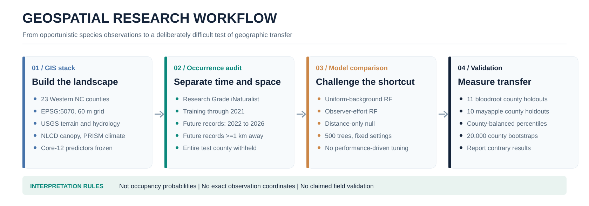

# Geographic transfer of forest-herb habitat models

**Research case study | Western North Carolina | GIS, spatial machine learning, and frozen external validation**

## The decision problem

Citizen-science plant observations are not random samples of the landscape. Records cluster where people can travel and where botanists choose to look. A habitat model can therefore seem accurate simply by remembering the geography of previous observations. This project asked a more demanding question:

**Can an environmental model trained on historical observations outside a county rank later, geographically separated observations within that withheld county better than a model based only on distance to known records?**

The case study summarizes completed research analyses, not a hosted prediction product or a validated field-survey locator.

## Study design

- **Study area:** 23 Western North Carolina counties on an EPSG:5070, 60 m analysis grid.
- **Target species:** bloodroot (*Sanguinaria canadensis*), mayapple (*Podophyllum peltatum*), and black cohosh (*Actaea racemosa*).
- **Occurrence audit:** research-grade iNaturalist observations, wild/noncaptive, publicly georeferenced, stated positional accuracy above zero and no more than 100 m, de-duplicated and thinned to one record per 100 m cell.
- **Temporal split:** observations through December 31, 2021 for training; January 1, 2022 through September 15, 2026 for future testing.
- **Independent future test:** observations at least 1 km from every historical focal-species occurrence.
- **Geographic holdouts:** remove every historical target occurrence from the test county and train only on other counties; background also excludes the withheld county.
- **Primary scope:** counties meeting the prespecified threshold of at least 15 eligible future observations.

### GIS and predictor pipeline

| Input | Derived information |
| --- | --- |
| USGS 3DEP elevation | Elevation, slope, directional aspect, TPI, wetness, drainage distance, and heat load |
| NLCD 2021 | Forest analysis mask and tree-canopy percentage |
| PRISM 1991–2020 normals | July maximum temperature and growing-season precipitation |
| USDA NRCS SSURGO | Soil pH and available-water capacity, prespecified secondary sensitivity extension |
| iNaturalist plant observations | Target-species presences and spring botanist-observation-effort proxy |

The frozen **Core-12** predictor set was elevation, slope, northness, eastness, approximately 300 m and 900 m TPI, TWI, distance to drainage, canopy cover, July maximum temperature, April–October precipitation, and McCune–Keon heat load.

The 60 m grid supports **regional ranking**, not fine-scale habitat suitability or exact plant location guidance. Underlying PRISM and soil datasets have coarser measurement support. The habitat scores are **presence/background discrimination scores, not calibrated occupancy probabilities**.

## Models and validation

Three prespecified approaches were compared:

1. **Uniform-background random forest:** background sampled uniformly from eligible training-county forest, excluding a 200 m zone around training presences.
2. **Effort-aware random forest:** same forest parameters and target presences, with background shaped by historical spring botanist-observer visits, one visit per observer/day/250 m cell; visits jittered at sigma 1 km, with 5% uniform background to maintain support.
3. **Distance-only null:** ranking determined solely by distance to the nearest training occurrence, a direct test of geographic memorization.

Each random forest used 500 trees, minimum leaf size 5, square-root feature selection, balanced class weights, random seed 42, and background at five times the training-presence count. No outcome-driven hyperparameter optimization was performed.

**Primary estimand:** the *county-balanced mean of county-median future-observation landscape percentiles*. Each held-out county contributes equally. Uncertainty for multi-county comparisons comes from 20,000 county-level bootstrap resamples, not bootstrap resampling of individual records.

## Results

| Species | Qualifying counties | Future observations | Effort RF | Uniform RF | Distance null | Effort minus distance (95% county-bootstrap interval) |
| --- | ---: | ---: | ---: | ---: | ---: | --- |
| Bloodroot | 11 | 288 | 0.684 | 0.653 | 0.526 | **+0.158** (0.030 to 0.280) |
| Mayapple | 10 | 246 | 0.666 | 0.596 | 0.509 | **+0.157** (0.068 to 0.241) |
| Black cohosh | 1 | 17 | 0.378 | 0.317 | 0.720 | **−0.342**; single-county descriptive result |

**Two multi-county tests succeeded against geographic memory.** Bloodroot and mayapple both showed positive effort-aware environmental-model advantages over the distance null, with the lower bounds of county-bootstrap 95% intervals above zero.

**Observer-effort correction was not universally better.** For mayapple, effort-aware versus uniform RF was +0.069 (95% CI +0.030 to +0.108). For bloodroot it was +0.031 (−0.055 to +0.121), an inconclusive comparison.

**The contrary result matters.** Only one county qualified for black cohosh; in that county the distance null exceeded both random forests. This cannot support a species-wide estimate. Adding regional SSURGO pH and water capacity did not consistently improve transfer for the two multi-county species.

For bloodroot, the effort-aware model captured 32.6% of future observations in the highest-ranking 10% of eligible reference landscape; mayapple captured 15.0%. Generalized ranking skill and top-decile concentration are different claims.

## Why the validation design matters

- A random train/test split can reward spatial autocorrelation.
- Holding out later observations alone can reward proximity to historical sites.
- Entire-county withholding plus time separation plus 1 km exclusion reduces those shortcuts.
- A distance-only null makes the shortcut measurable.
- County-level bootstrap avoids treating correlated records within one county as independent replications.
- Frozen settings and published negative results resist selective reporting.

## Scope, materials, and limitations

This folder is a **public-safe, aggregate research write-up with editable SVG diagrams**. It is **not a reproduction package**. It does not include scripts, source rasters, raster predictions, precise occurrence coordinates, or unreviewed derived location layers. A separate, auditable code-and-data release would require reviewing licensing, source snapshots, provenance hashes, spatial-data sensitivity, and reproducibility. The figures are visual presentations of previously calculated summaries; no models were rerun to produce them.

Additional limitations include opportunistic observation bias, incomplete measurement of failed searches and observer-hours, species-by-geography variation, and a single-county black-cohosh contrast. Future evaluations should compare the original expert-weighted GIS model on these same frozen test sets and assess transfer into additional regions.

## Selected public data sources

- [USGS 3DEP](https://www.usgs.gov/3d-elevation-program)
- [Multi-Resolution Land Characteristics (NLCD)](https://www.mrlc.gov/)
- [PRISM Climate Group](https://prism.oregonstate.edu/)
- [USDA NRCS SSURGO](https://www.nrcs.usda.gov/resources/data-and-reports/soil-survey-geographic-database-ssurgo)
- [iNaturalist](https://www.inaturalist.org/)

**Status:** Independent, unpublished research case study. All descriptive values above come from the completed project’s frozen confirmatory result summaries and research manuscript. No peer-review or production-deployment claim is made.

[Back to portfolio](../../README.md)
