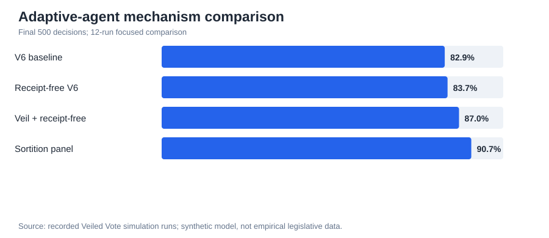
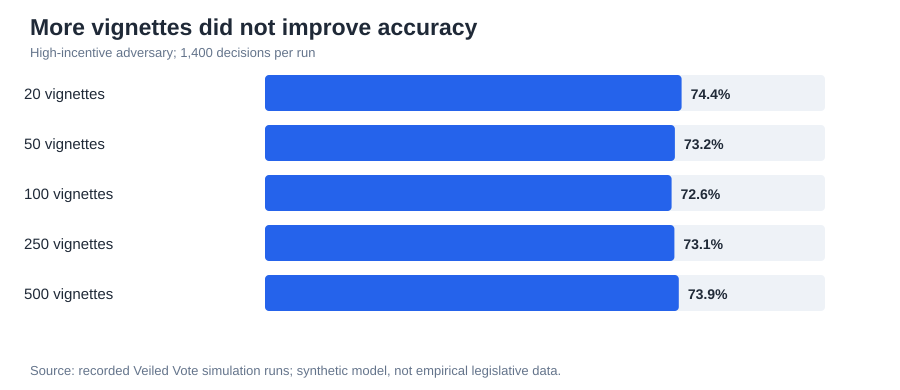
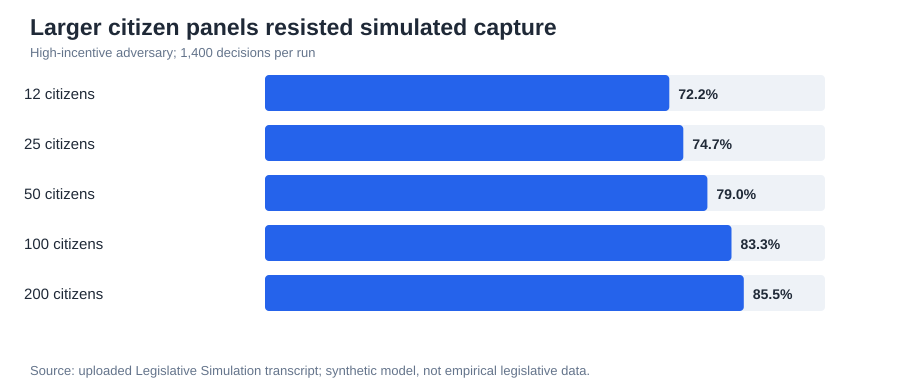

# Veiled Vote — Strategic Reporting, Mechanism Design & Institutional Simulation

**Completed exploratory simulation series | Synthetic agents | Adaptive adversaries | Institutional design**

> **Evidence boundary:** This case study reconstructs the actual code, console outputs, and narrative recorded in the supplied *Legislative Simulation* ChatGPT transcript. These are exploratory, synthetic simulation results—not observations of real legislators, validated institutional effects, or evidence that any constitutional arrangement should be adopted. The transcript contains interrupted runs and successive model revisions; results from different calibrations must not be pooled as one experiment. The source transcript is not published here.

## 01 · Research question: can institutions change the incentives to misreport?

The project began with persistent legislator preference profiles and strategic-report consistency checks. The key identification problem was that **coherent strategic self-interest can look indistinguishable from sincere preference reporting** when only the reports themselves are observed.

The research pivot was to modify incentives rather than attempt to classify each report as honest or dishonest:

- **Receipt-freeness:** reduce the ability of another actor to verify a private report and enforce a bargain.
- **Veiled elicitation:** elicit abstract judgments before the target policy is known, making distortion harder to aim.
- **Persistent profiles:** allow distortions to affect multiple future decisions, not just the current bill.
- **Sortition:** compare the legislator-centered design with a randomly selected citizen panel under explicitly modeled assumptions.

Secrecy is not automatically receipt-freeness: a real protocol would have to resist unofficial receipts, recording, collusion, and information leakage.

## 02 · First test: adaptive agents change the picture

The transcript contains a Python simulation with 101 simulated legislators across three factions, 101 simulated citizens for the benchmark, five policy dimensions, 2,000 bill decisions per run, and five empirical forecasting pools. The focused comparison below averaged **12 runs per architecture**, with the reported outcome measured over the **final 500 decisions**. Factions used a simple epsilon-greedy bandit over discrete manipulation intensities; they were *not* full reinforcement-learning language-model agents.

<table><tr><td width="56%" valign="top"></td><td valign="top"><strong>Initial result</strong>  Combining maximum veil uncertainty with receipt-freeness increased simulated policy accuracy from <strong>82.9% to 87.1%</strong> relative to V6. Receipt-freeness alone changed accuracy little but reduced learned attack intensity from approximately <strong>0.61 to 0.32</strong>.  <strong>Qualification</strong>  The citizen panel scored 90.7%, close to the sincere-legislator benchmark of 90.2%, but its agents were explicitly modeled without faction, donor, or reelection incentives. This is an assumption-sensitive benchmark, not evidence of real-world superiority.</td></tr></table>

| Architecture | Late accuracy | Decision disagreement with sincere benchmark | Learned attack intensity |
| --- | ---: | ---: | ---: |
| V6 persistent profiles | 82.9% | 13.8% | 0.61 |
| Receipt-free V6 | 83.7% | 13.1% | 0.32 |
| Veil alone, moderate uncertainty | 81.8% | 15.3% | 0.63 |
| Veil + receipt-free, moderate uncertainty | 84.4% | 12.0% | 0.32 |
| Veil + receipt-free, high uncertainty | 87.1% | 8.4% | 0.34 |
| Sortition benchmark | 90.7% | 2.0%* | Not applicable |

*For sortition, disagreement is **not strategic manipulation**: it compares citizen-panel decisions with a sincere-legislator reference. The source transcript's tabular attack-intensity field for sortition is an artifact of action sampling and should not be interpreted as citizen manipulation.*

**Interpretation:** The combination appeared more useful than either defense alone in this specification. This did not establish receipt-freeness in a cryptographic or institutional sense: the model implemented reduced enforceability through parameters.

## 03 · Second test: let adversaries attack the defenses

The next simulation allowed factions to invest in **unofficial receipt recovery**, **reverse-engineering vignette-to-bill mappings**, and **direct manipulation**. A revised coalition mechanism addressed an earlier modeling weakness in which competing factions sometimes canceled each other.

The reported no-manipulation ceiling in this revised environment was approximately **91.4%**.

| Adversarial environment | Late accuracy | Attack-induced outcome flips | Learned attack effort |
| --- | ---: | ---: | ---: |
| Strong defenses; circumvention costly | 87.9% | 4.3% | 0.60 |
| Strong defenses; circumvention cheap | 86.6% | 5.9% | 0.64 |
| Receipt-freeness partly leaky | 86.8% | 5.7% | 0.63 |
| Veil partly reverse-engineered | 86.4% | 6.2% | 0.61 |
| Both partly compromised | 85.9% | 6.7% | 0.63 |
| Both largely compromised | 83.1% | 9.7% | 0.69 |

**Interpretation:** The simulated defenses remained useful only to the extent that circumvention retained meaningful costs. These results come from a **different calibration** and are not direct treatment-effect estimates relative to the first test.

## 04 · Stress test: what happens when attackers can substitute strategies?

The final recorded experiment used **1,400 repeated decisions per run** and a high-incentive adaptive adversary. It compared two distinct design levers: the number of abstract vignettes used by the legislator mechanism and the size of a randomly selected citizen panel. The transcript reports aggregated late-period results; the full independent source repository and machine-readable run logs were not provided.

<table><tr><td width="55%" valign="top"></td><td valign="top"><strong>Legislator mechanism: larger vignette banks did not help much</strong>  Accuracy stayed around <strong>72.6–74.4%</strong> as the bank grew from 20 to 500 vignettes. Attack-induced flips stayed around <strong>14.9–16.9%</strong>.  The interpretation in the transcript is that agents shifted effort toward other attack channels when reverse-engineering became harder. Enlarging one defense did not remove the incentive to attack.</td></tr></table>

<table><tr><td width="55%" valign="top"></td><td valign="top"><strong>Sortition mechanism: panel size mattered in this model</strong>  Accuracy increased from <strong>72.2%</strong> for a 12-person panel to <strong>85.5%</strong> for a 200-person panel. Attack-induced flips declined from <strong>17.3% to 3.8%</strong>.  These findings depend on the simulated capture model, participant selection, and aggregation rules; they cannot be generalized directly to real citizen assemblies.</td></tr></table>

| Legislator vignette bank | Late accuracy | Attack-induced flips | Citizen panel size | Late accuracy | Attack-induced flips |
| ---: | ---: | ---: | ---: | ---: | ---: |
| 20 | 74.4% | 14.9% | 12 | 72.2% | 17.3% |
| 50 | 73.2% | 16.3% | 25 | 74.7% | 14.8% |
| 100 | 72.6% | 16.9% | 50 | 79.0% | 10.0% |
| 250 | 73.1% | 16.5% | 100 | 83.3% | 6.4% |
| 500 | 73.9% | 16.1% | 200 | 85.5% | 3.8% |

**Do not equate the table's left and right row labels.** Vignette-bank size and citizen-panel size are different experimental parameters. The visualizations intentionally present them separately.

## 05 · Research conclusion: from truth detection to institutional hybrids

The original aim was to elicit sincere common-interest judgments from strategically motivated representatives. The later simulations exposed a challenge: even sophisticated defenses can induce **attack substitution** rather than eliminate manipulation.

The resulting **next hypothesis, not a completed test**, is a hybrid institutional architecture:

1. Legislators retain agenda setting, drafting, negotiation, voting, and public accountability.
2. Independent empirical forecasting pools estimate policy consequences.
3. A randomly selected citizen panel evaluates those consequences through structured deliberation.
4. The panel's aggregate signal is made available to legislators and the public.
5. A future experiment varies the signal's institutional force: advisory only, mandatory reconsideration, public explanation, or a dual-key decision rule.

The unanswered research question is: **How much procedural influence would an independent common-interest signal need before strategic distortion becomes less rewarding?** No simulation of those five hybrid arms is included in the supplied transcript.

## 06 · Reproducibility and limitations

**What is verifiable from the supplied transcript:** Python simulation code fragments, printed numerical outputs, experiment parameter settings, failed/interrupted attempts, and the researcher's interpretations. The three SVG figures in this folder are **new visualizations of those reported outputs**, not screenshots from the original execution environment.

**What is not yet established:** a complete, versioned executable repository; automated tests; independently rerun results; full random-seed manifests; raw per-agent traces; coalition network data; and empirical external validation. The simulations used synthetic agents and stipulated incentives. The earlier adaptive model used an epsilon-greedy bandit, not autonomous LLM negotiators. Differences across experimental stages include outcome definitions, coalition behavior, attack channels, and calibrations, so their accuracy figures are not interchangeable.

**Research status:** Exploratory simulations completed and results documented from the provided transcript. The hybrid architecture remains a proposed next experiment. No claim of real-world legislative efficacy, production deployment, or peer review.

[Back to portfolio](../../README.md)
